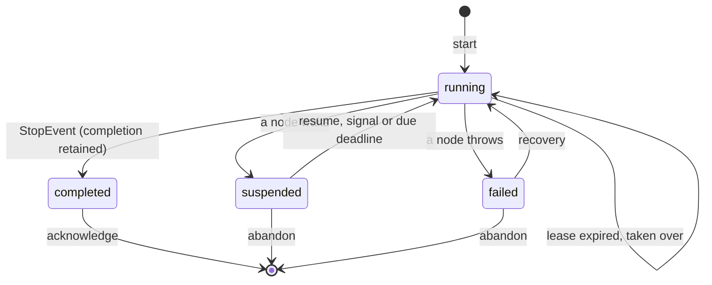
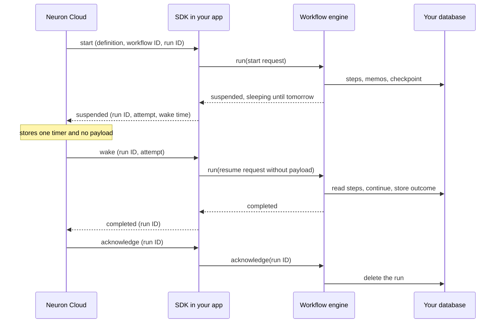

# Durable Platform Readiness

Can the Neuron AI Workflow engine be driven by an external orchestration platform ("Neuron Cloud"), the way Temporal, Restate and Inngest drive their frameworks? This document maps what Neuron already provides, what is missing, and what the architecture gains and costs.

- **Analysed:** `neuron-core/neuron-ai` 4.1.2 as installed in `vendor/`. Its `src/Workflow` is identical to the local `../neuron-ai` checkout (branch `4.x`, commit `a533d8e2`).
- **Method:** reading the source and its tests. Nothing was executed.
- **Paths** such as `src/Workflow/WorkflowEngine.php` are relative to the neuron-ai repository.
- **Date:** 2026-10-06. Revised 2026-10-07 after review: decisions recorded in section 12, and the heartbeat (G6), the segment budget (section 10) and inputs (section 11) explained in more detail.
- **Status of the core changes (2026-10-07):** typed refusals (G2) and the richer snapshot (G3) are released in neuron-ai 4.1.4, which the SDK must require as its minimum. The segment budget (G1) is not being introduced. See section 10.
- **Corrected on 2026-10-07** after a code-verified pass over the engine for the SDK design: the run ID format, what an early wake-up writes, when a retained result can be read, and three redelivery rules added under the table in section 6. The SDK design is in `SDK_DESIGN.md`.

## Contents

1. [Verdict](#1-verdict)
2. [Vocabulary](#2-vocabulary)
3. [How other platforms connect framework and platform](#3-how-other-platforms-connect-framework-and-platform)
4. [Neuron's durable model](#4-neurons-durable-model)
5. [The control surface a platform can drive](#5-the-control-surface-a-platform-can-drive)
6. [Does it hold when things go wrong?](#6-does-it-hold-when-things-go-wrong)
7. [Readiness map](#7-readiness-map)
8. [Pros of the current architecture](#8-pros-of-the-current-architecture)
9. [Cons and gaps](#9-cons-and-gaps)
10. [Suggested changes to Neuron core](#10-suggested-changes-to-neuron-core)
11. [What this implies for the SDK and the protocol](#11-what-this-implies-for-the-sdk-and-the-protocol)
12. [Decisions](#12-decisions)

---

## 1. Verdict

**Yes. The Workflow engine already exposes the complete loop an orchestrator needs, and a first working platform can be built without changing Neuron.**

A run can be started idempotently, suspended on a timer or an external event, inspected, resumed with a guarded answer, taken over after a crash, and completed with an acknowledged hand-off. Each of these is a small public API with tests behind it. The engine's own design notes (`src/Workflow/AGENTS.md`, section "Platform-owned coordination") already describe a platform SDK as an *invocation gateway*: rebuild the workflow, call `run($request)`, read the outcome, schedule the next call.

The property that makes this safe is that **correctness lives in the engine, not in the caller**. Every write is conditional on the run's control record, so a duplicated, late, early or concurrent delivery is refused instead of corrupting a run. The platform can be a plain at-least-once scheduler and still never cause a completed step to run twice.

What Neuron does not have falls into two groups:

1. **What a platform exists to add.** Timer scheduling, event routing, retry policies, queues and rate limits, cron, a searchable list of runs, dashboards. The core deliberately has none of these.
2. **Gaps in the core that will shape the SDK and the protocol if left as they are.** The three that matter most:
   - a running segment cannot be asked to stop cleanly at a step boundary, which is awkward for PHP invoked over HTTP with execution time limits (gap G1);
   - most refusals are plain exceptions that differ only by their message, where a protocol needs stable codes (G2);
   - nothing records which version of a workflow definition a run started on (G7).

Section 7 is the full map, sections 8 and 9 the pros and cons, section 10 the suggested core changes.

## 2. Vocabulary

| Term | Meaning |
|---|---|
| Durable execution | A workflow whose progress survives crashes and restarts. Every completed step is recorded, so the workflow continues from the last recorded step instead of starting over. |
| Journal | The ordered record of completed steps and their results. Whoever stores the journal holds the workflow's data. |
| Replay | Running workflow code again after a restart, answering already completed steps from the journal instead of executing them. |
| At-least-once delivery | A message is guaranteed to arrive, possibly more than once. Every networked orchestrator works this way, so duplicates are normal. |
| Idempotent | Safe to perform twice: the second attempt has no additional effect. |
| Fencing | A guard that lets only the current owner of a run write to it. A process that was presumed dead and wakes up late (a "zombie") cannot overwrite newer progress. |
| Lease | A time-limited claim on a run. If the owner stops renewing it, another process may take over after it expires. |
| Heartbeat | A sign of life from the process that owns a run. Each heartbeat renews the lease. When heartbeats stop, the lease runs out and the run can be taken over. |
| Control plane, data plane | The control plane decides when and what to run. The data plane carries the inputs, state and results. |
| Segment (Neuron) | One uninterrupted execution of a run, from the moment a process claims it until it suspends, completes or fails. |

## 3. How other platforms connect framework and platform

Every durable platform has two halves: an SDK inside your process and a server somewhere else. That split raises the same five questions everywhere, and each product's design is its set of answers.

1. **Registration.** How does the server learn which workflows exist and how to reach them?
2. **Transport.** Does the worker pull work from the server, or does the server push work to an endpoint?
3. **Journal ownership.** Who stores step results? If the server does, the journal crosses the network on every invocation.
4. **Wake-ups.** Who remembers that a run must continue at 09:00, when event X arrives, or 30 seconds after a failure?
5. **Arbitration.** Who guarantees that one process at a time executes a run and that duplicates are ignored?

### Temporal

- **Transport: pull.** Workers are long-running processes in your infrastructure. They open outbound gRPC connections and long-poll *task queues*. The server never calls into your code.
- **Journal: on the server.** The Temporal Service stores an append-only *Event History* for each workflow execution.
- **Execution.** On each *Workflow Task* the SDK replays the history through your workflow code to rebuild its state, runs the code until it blocks, and sends back *Commands* ("schedule this activity", "start this timer"). The server records them and schedules the work. Replay only works if workflow code is deterministic, so anything with side effects lives in *Activities*: separate tasks with their own retries and timeouts.
- **Wake-ups and arbitration: the server.** Durable timers, signals, retry policies and task routing all live there.
- **Data.** Inputs, results and history pass through the server and are stored by it. Client-side encryption is possible.
- **PHP.** An official SDK exists, but it requires RoadRunner to run long-lived workers.

### Restate

- **Transport: push.** A service is an HTTP endpoint (or a Lambda) that embeds the SDK. Its URL is registered as a *deployment* and the server discovers its handlers. For each invocation the Restate Server opens a bidirectional HTTP/2 stream to the service.
- **Journal: on the server**, together with the key-value state of *Virtual Objects* and *Workflows*.
- **Execution.** The server sends the invocation with the journal recorded so far. The SDK streams back every new journal entry (`ctx.run` results, sleeps, calls) and the server persists it. When the handler can only wait, the SDK suspends and the connection closes. The server invokes again later and the journal is replayed up to the suspension point.
- **Arbitration: the server**, which enforces a single writer per key.
- **Versioning.** Deployments are immutable. An invocation in flight stays pinned to the deployment it started on.
- **PHP.** No official SDK (TypeScript, Java, Kotlin, Python, Go, Rust, Ruby). A community PHP SDK exists.

### Inngest

- **Transport: push over plain HTTP.** The application exposes one `serve()` endpoint and *syncs* its function list, with triggers and flow-control settings, to Inngest.
- **Journal: on the server.** Step results are stored by Inngest.
- **Execution.** Inngest calls the endpoint with the triggering event and the saved results of earlier steps. The SDK runs the function from the top: completed `step.run` calls return their saved result, the next new step executes, and its result goes back to Inngest, which stores it and calls again. `step.sleep` and `step.waitForEvent` tell Inngest to call back later. No compute runs in between.
- **Flow control and retries: the platform.** Concurrency, throttling, debounce, priority and batching are platform features.
- **PHP.** No official SDK (TypeScript, Python, Go).

### DBOS: the closest relative

- **Journal: in your own Postgres.** The library (DBOS Transact) checkpoints workflows and steps into the application's database. The application is durable with no server at all.
- **Conductor** is an optional control plane. Workers open an outbound WebSocket to it. Conductor stores no workflow data and never touches the database. It notices dead workers and tells healthy ones to recover their workflows, and it powers dashboards and management actions (cancel, resume) by asking workers on demand. If Conductor is down, workflows keep running.
- **PHP.** No SDK.

### Side by side

| | Temporal | Restate | Inngest | DBOS + Conductor | Neuron + Neuron Cloud |
|---|---|---|---|---|---|
| Transport | Worker pulls (gRPC long-poll) | Server pushes (HTTP/2 stream) | Server pushes (HTTP request) | Worker dials out (WebSocket) | To be designed. The engine is transport-neutral |
| Journal and state live in | The platform | The platform | The platform | Your Postgres | Your database or Redis |
| Crosses the wire per invocation | History and payloads | Journal and payloads | Event and step results | Commands, metadata on demand | IDs, fences, status, one wait description |
| Rule for workflow code | Deterministic. Side effects in activities | Deterministic between journaled operations | Deterministic between steps | Deterministic between steps | Routing is recorded, not recomputed (section 4) |
| Timers, events, retries | Platform | Platform | Platform | The library, in your process | Platform. The core has no scheduler |
| Runs without the platform | No | No | No | Yes | Yes |
| Official PHP SDK | Yes, needs RoadRunner | No | No | No | Native |

### What this tells us

Temporal, Restate and Inngest keep the journal on the platform. That puts the platform on the data path: it sees every input and result, every step costs a network round trip, and nothing runs while it is unreachable. In exchange the platform can do everything alone: show each step, retry any step, pin code versions.

DBOS and Neuron keep the journal in the application's database. The platform shrinks to the control path: it decides when a run should continue and tells the application, which does the rest locally. Neuron Cloud would follow this model.

One difference from DBOS matters. The DBOS library runs sleeps, queues and schedules inside the application process. Neuron's core has no scheduler, and a suspended run holds no process at all. `sleepUntil()` and `awaitEvent()` describe a wait and stop. Something outside has to call back at the right moment. That "something" is exactly the job Neuron Cloud would take.

## 4. Neuron's durable model

A Neuron workflow is a graph. A node handles one event type and returns the next event, until a `StopEvent`. Durability sits on that graph as follows.

**What is journaled.** Each completed node execution is a *step*, stored with the event it returned and the state after it (`Segment::runNodeStep()`, `StepResult`). Inside a node, `memoize('name', fn () => ...)` records one sub-operation, such as one LLM call or one tool call. A step is the coarse unit, a memo the fine one.

**How replay works.** Every segment starts from the run's original start event and walks the graph again. Before running a node it looks for the step's record (`<runId>/<NodeClass>-<index>`). If the record exists, its stored event and state are used and the node does not execute. Only the node that was interrupted or failed runs again, from its first line, with its memos and its earlier answers returned from storage.

Routing is therefore read back, never recomputed. That is why workflow authors face almost no determinism rules. The one rule: a node must reach its waits in the same order each time it runs, and side effects between waits belong inside `memoize()`.

**Identity.** The *workflow ID* is a stable business address (`order:123`, a chat thread ID) and holds at most one run at a time. Each run has a *run ID*. Each time a process takes ownership of the run, the run's *execution attempt* number goes up by one.

**Suspension.** A node waits with `sleepUntil($time)`, `awaitEvent($name, $deadline)` or `interrupt($customRequest)`. The run is committed as `suspended` together with a checkpoint, the process ends, and nothing stays in memory. The wait is described by an `InterruptRequest`, which serialises to a small JSON envelope: `interruptId`, `type`, then either `eventName` and `expiresAt`, or `wakeAt`. A run exposes one current interruption at a time. Waits raised by other parallel branches are deferred and promoted in arrival order.

**Ownership.** All records of a workflow ID live in one partition of the application's store:

| Key | Purpose |
|---|---|
| `__ignition` | The immutable start event and the run ID |
| `__control` | Run ID, status, execution attempt, lease deadline, the current interruption with its accepted answer, deferred steps |
| `<runId>/__checkpoint` | The state of a suspended run |
| `<runId>/__outcome` | The final state, when completion is retained |
| `<runId>/<stepId>` | One step's result |
| `<runId>/<stepId>::<memo>` | One memoized result |

Every write (step, memo, suspension, failure, cleanup) is a single atomic "write only if `__control` still holds the bytes I read". `PersistenceInterface` offers nothing else: `get()` plus `initializeIfAbsent()`, `writeIfUnchanged()` and `deleteIfUnchanged()`. A process that lost ownership can finish what it holds in memory but cannot commit any of it.

**Liveness.** A process that dies abruptly (out of memory, killed by a deploy, a PHP fatal timeout) cannot record that it failed. The run stays marked `running`, and from outside a dead worker looks exactly like a slow one. A lease settles the question. The owner stamps the run with a deadline ("mine until 10:10") and keeps moving it forward while it works. Each renewal is a *heartbeat*. If the deadline passes with no renewal, the run is treated as dead and another process may claim it. Without this a crashed run would stay `running` forever, and nobody could retry it safely.

In Neuron the lease is opt-in (`setLeaseTimeout()`; an `Agent` holds ten minutes by default). The deadline is stored in `__control` and every step commit renews it in the same write, so the heartbeat costs nothing extra.

**Completion.** By default a clean finish deletes the partition. With `retainCompletionUntilAcknowledged()` the final state is kept until `acknowledge($runId)`.

### Concept map

| Concept | Temporal | Restate | Neuron |
|---|---|---|---|
| Stable identity | Workflow ID | Object key, workflow ID | Workflow ID (`setWorkflowId()`, `for()`) |
| One execution | Run ID | Invocation ID | Run ID, generated or reserved by the caller |
| Journal | Event History, on the server | Journal, on the server | Step and memo records in `PersistenceInterface` |
| Recorded side effect | Activity | `ctx.run()` | A node step, or `memoize()` inside a node |
| Durable timer | Timer | `ctx.sleep()` | `sleepUntil()`, a `SleepUntilRequest` |
| External input | Signal, Update | Awakeable, durable promise | `awaitEvent()`, answered by `ExecutionRequest::signal()` or `::resume()` |
| Human in the loop | Signal | Awakeable | `interrupt(new ApprovalRequest(...))` |
| Single owner | Enforced by the server | Enforced by the server | Execution attempt and conditional writes on `__control` |
| Liveness | Task and heartbeat timeouts | Inactivity timeouts | Lease (`setLeaseTimeout()`) |
| Idempotent start | Workflow ID conflict policy | Idempotency key | Reserved run ID with `recoverFailed: true` |
| Result hand-off | History retention | Journal retention | `retainCompletionUntilAcknowledged()` and `acknowledge()` |
| Read status | Describe, Query | Shared handlers, introspection | `inspect()`, a `WorkflowRunSnapshot` |
| Stop a run | Cancel, Terminate | Cancel, Kill | `abandon()`, refused while a lease is live |
| Code versioning | Patching, Worker Versioning | Immutable deployments | None |
| Child workflows | Child Workflows | Service-to-service calls | None in core |
| Retry policy | Per activity | Built in | None. The run is marked `failed` and the caller decides |

## 5. The control surface a platform can drive

Everything a platform needs is reachable through `Workflow::run(ExecutionRequest)` and three by-ID verbs on `WorkflowEngine`.

| Intent | Call | What the engine guarantees |
|---|---|---|
| Start a run | `run(ExecutionRequest::start($event, runId: $id, recoverFailed: true))` | Creation is an atomic insert-if-absent. With a reserved run ID a redelivered start never runs twice: it is refused with a typed `RunInFlightException` describing the existing run, or it takes over its own run if that run failed or its process died. It never replaces another run. |
| Answer the current wait | `run(ExecutionRequest::resume($payload, $runId, $attempt))` | The answer and the ownership claim are committed in one write. A wrong run ID or attempt is rejected. Once accepted, the answer cannot change. |
| Deliver a named event | `run(ExecutionRequest::signal($name, $payload, $runId, $attempt))` | As above, and the name must match the current wait or nothing is persisted. |
| Fire a timer or deadline, or recover a run | `run(ExecutionRequest::resume(null, $runId, $attempt))` | The engine checks the clock itself. Too early: it returns the still suspended state, with the attempt and the wait unchanged (it only rewrites the checkpoint record). Refused while another process holds a live lease. |
| Read a run | `$engine->inspect($workflowId)` | Read-only. Returns run ID, status, attempt, current interruption and the original start event. |
| Read a retained result | `run(ExecutionRequest::resume(expectedRunId: $runId))` | Returns the stored final state without executing any node, but only when the run is `completed`. On any other status the same call is a wake-up or a recovery, so check the status with `inspect()` first. |
| Release a retained result | `$engine->acknowledge($workflowId, $runId)` | Deletes exactly that completed run. |
| Discard a run | `$engine->abandon($workflowId, $runId, $attempt)` | Fenced delete of a suspended, failed or dead run. Refuses a live lease and a retained completion. |

`inspect`, `acknowledge` and `abandon` need only the store and the serializer (`new WorkflowEngine($persistence, $serializer)`), so a management endpoint needs no knowledge of the workflow classes. The execution calls need the definition, which the application rebuilds through its own factory on every invocation.

One platform invocation amounts to this inside the application. `$registry` stands for the SDK piece that does not exist yet; everything else is current Neuron API.

```php
// The application's factory configures persistence, serializer and lease.
$workflow = $registry->make($definition, $workflowId)
    ->retainCompletionUntilAcknowledged();

$request = match ($verb) {
    'start'  => ExecutionRequest::start($startEvent, runId: $runId, recoverFailed: true),
    'resume' => ExecutionRequest::resume($payload, $runId, $attempt),
    'signal' => ExecutionRequest::signal($eventName, $payload, $runId, $attempt),
    'wake'   => ExecutionRequest::resume(null, $runId, $attempt), // timer, deadline or recovery
};

try {
    $state = $workflow->run($request);

    $state->getStatus();            // Suspended or Completed
    $state->getRunId();             // fences for the next call
    $state->getExecutionAttempt();
    $state->getInterruptRequest();  // what the run waits for: event name and deadline, or wake time
} catch (WorkflowRefusedException $refused) {
    // The engine protected the run. Report $refused->reason->value; the platform re-plans.
}
```

A failed node does not return a state: the failure is committed first, then the exception reaches the caller. The SDK reads the run ID and attempt of the failed run from `inspect()`, or from the `execution` context of the `WorkflowError` observability event.

### Lifecycle



Every arrow into `running` raises the execution attempt by one. Without retention, a clean finish deletes the partition directly.

### What the platform does with each outcome

| Outcome reported by the SDK | Platform's next action |
|---|---|
| `suspended` on `sleep_until`, with `wakeAt` | Store one timer. At `wakeAt` send a fenced resume without payload. |
| `suspended` on `wait_for_event`, with `eventName` and optional `expiresAt` | Store one subscription for (workflow ID, event name) and, if there is a deadline, one timer. Deliver whichever comes first. |
| `completed` | Record it, then acknowledge so the workflow ID is free again. |
| `failed` | Apply the retry policy: schedule a fenced resume without payload after a back-off, or stop and alert. Only the failed node runs again. |
| No answer within the lease window | Send the resume without payload anyway. If the worker is alive the engine refuses. If it died, the run is taken over. |
| A refusal (stale, in flight) | Call `inspect` and re-plan from the application's truth. |



## 6. Does it hold when things go wrong?

A platform talks to applications over a network, so messages get lost, repeated and reordered, and workers die mid-task. The table lists the standard failures and what the engine does today.

| # | What goes wrong | What the engine does | What is left for the platform |
|---|---|---|---|
| 1 | The start is delivered twice | The second insert-if-absent fails. Same reserved run ID: refused with `RunInFlightException` carrying the run's status, attempt and current wait. | Treat the refusal as "already started" and read the state from it. |
| 2 | The worker dies mid-node (OOM, timeout, deploy) | The run stays `running`. After the lease expires, a resume without payload claims it, replays committed steps from storage and re-runs only the node that was in flight. Its memos return recorded values. | Send the recovery call after the lease window. |
| 3 | The dead worker was only slow and wakes up | Its next write fails: `__control` no longer holds what it read. It cannot commit a step, a memo, a suspension or a completion. | Nothing. Side effects it performed outside `memoize()` may have happened twice. |
| 4 | A node throws | `failed` is committed and the lease cleared before the exception surfaces. Completed steps and memos are kept. | Decide whether and when to retry. |
| 5 | The response is lost after a suspension | The suspension is durable. A redelivered start is refused with the run's current state attached. A redelivered answer is rejected as stale. A resume without payload, fenced by run ID only, returns the suspended state and its wait. | Poll or inspect to learn the new wait. |
| 6 | The response is lost after completion | With retention, the final state stays readable (`resume(expectedRunId: $runId)`) without executing any node, until acknowledged. **Without retention the partition is gone and a redelivered start runs the workflow again.** | Always enable retention. Acknowledge after recording. |
| 7 | An answer is delivered twice | The first delivery claims the run (attempt + 1). The second carries the old attempt and is rejected as stale. | Treat stale as "already delivered" and inspect. |
| 8 | The worker dies right after accepting an answer | The answer was stored in `__control` in the same write as the claim. A resume without payload recovers the run and delivers that same answer. A different answer for the same wait is refused. | Send the recovery call. |
| 9 | A timer fires early (clock skew) | The engine compares the deadline with its own clock, returns the still suspended state and leaves the attempt unchanged. | Reschedule. |
| 10 | A late answer arrives for a wait the run already passed | Run ID or attempt no longer match. Rejected. | Drop it. |
| 11 | Two workers race for the same resume | One conditional write wins. The other gets an exception and commits nothing. | Nothing. |
| 12 | A signal carries the wrong event name | Refused. The payload is not persisted. | Hold the event for the right wait. |
| 13 | Recovery is sent while the worker is alive | Refused: the lease is live. | Try again after the lease deadline. |

Rows 2 and 13 depend on a lease. Without one, a resume without payload takes over a `running` run immediately, whether its worker is alive or not, and a redelivered start cannot recover a run whose worker was killed. **A platform SDK must set a lease and completion retention on every segment it runs.** Neither is stored with the run: a single segment run without retention deletes the run when it completes.

Three redelivery rules, observed by running the engine, refine the table:

- **A start redelivered after its run failed runs the failed node again.** With `recoverFailed: true` that is what the flag means, so a redelivered start is a retry nobody scheduled. The platform must not redeliver a start once it holds a `failed` report.
- **An answer or a signal must carry the attempt as well as the run ID.** Fenced by the run ID alone, a duplicate answer is accepted by the next wait, and a duplicate signal too when the next wait has the same event name.
- **An outcome label is not proof of what is stored.** If the store fails during a commit, the segment reports a failure while the record stays `running` under its lease. The SDK should report the snapshot it reads after the call, and the platform should plan from that.

Most rows have a dedicated test in `tests/Workflow/`: `WorkflowDuplicateRequestTest`, `WorkflowManagedExecutionTest`, `WorkflowLeaseTest`, `WorkflowIdentityTest`, `WorkflowAbandonTest`, `SuspendTypesTest` and `Executor/InterruptLifecycleTest`.

## 7. Readiness map

Status values: **Ready** (usable as it is), **SDK** (needs an adapter in this package), **Platform** (to be built in Neuron Cloud), **Gap** (missing in the core; numbers refer to section 9.2).

### Durability

| Capability | In Neuron today | Status |
|---|---|---|
| Step journal and replay | `Segment`, `WorkflowRunStore` | Ready |
| Fine-grained memoization | `Node::memoize()`, `recallMemo()` | Ready |
| Storage safe for many processes | `DatabasePersistence`, `EloquentPersistence`, `RedisPersistence` | Ready. `FilePersistence` and `InMemoryPersistence` are single-process only |
| Single-owner fencing | Execution attempt and conditional writes | Ready |
| Crash detection and takeover | Lease stored in `__control` | Ready, opt-in. Renewed only at step commits (G6) |
| Idempotent start | Reserved run ID, `recoverFailed` | Ready |
| Protection against lost responses | `retainCompletionUntilAcknowledged()`, `acknowledge()` | Ready. The SDK must switch it on |

### Waiting

| Capability | In Neuron today | Status |
|---|---|---|
| Durable timer | `sleepUntil()` | Ready as a primitive. Platform schedules the wake-up |
| External event with a deadline | `awaitEvent()` | Ready as a primitive. Platform routes the event |
| Human approval, custom waits | `interrupt()`, `ApprovalRequest` | Ready |
| Waits in parallel branches | Deferred, promoted one at a time | Ready. Only the current wait is visible (G10) |
| Event buffering, fan-out, correlation | None. Signals are "neither broadcast nor queued" | Platform |

### Control

| Capability | In Neuron today | Status |
|---|---|---|
| Inspect a run | `WorkflowEngine::inspect()` | Ready. The snapshot is minimal (G3) |
| Cancel a run | `abandon()` | Partial (G9) |
| Machine-readable refusals | Two typed exceptions; the rest differ by message | Gap (G2) |
| Bounded work per invocation | `setMaxSteps()` fails the run. No clean yield | Gap (G1) |
| Definition versioning | None | Gap (G7) |

### Operations

| Capability | In Neuron today | Status |
|---|---|---|
| Retry policy, back-off, dead-letter | None. The run is marked `failed` | Platform. No retryable or terminal distinction (G5) |
| Cron, delayed start | None | Platform |
| Concurrency limits, rate limits, queues | One run per workflow ID, nothing more | Platform |
| List of runs, search, history | None. The core keeps no history and cannot list runs (G11) | Platform |
| Step timeline and metrics | PSR-14 events carrying run ID and attempt | SDK forwards metadata |
| Live output streaming | Channels (Redis, Pusher, Mercure), one per segment | Ready, and independent of the platform |

### Integration

| Capability | In Neuron today | Status |
|---|---|---|
| Definition registry and factory | "Reconstruction is the factory's job" | SDK |
| Invocation endpoint or worker, request signing | None | SDK |
| Outcome reporting, run registration | None | SDK |
| Start input from JSON | The start event is a PHP object (G8) | SDK, with a developer-supplied hydrator |
| Graph description for discovery | `WorkflowGraph`, through a custom `ExporterInterface` | SDK |
| Child workflows, call-and-wait | None | Platform, built on `awaitEvent()` |

## 8. Pros of the current architecture

**1. The platform never holds customer data.** State, prompts, tool input and output, step results and human-approval details stay in the application's store. The platform's storage is small and uniform (IDs, statuses, timers, subscriptions), with no payload size limits to manage and a much simpler compliance story to sell.

**2. The platform is off the hot path.** A step commits with one local database write. Nothing crosses the network between steps, where Inngest pays an HTTP round trip and Restate a journal write to the server. A segment runs at local speed, and the platform sees two or three messages per segment instead of one or more per step. That is cheaper to operate and leaves room on price.

**3. Correctness does not depend on the platform.** The engine arbitrates ownership with conditional writes and is the authority on time: it checks deadlines against its own clock. A platform bug, a duplicate or a clock skew produces a refusal or a harmless poll, never a corrupted run. This lowers the risk of a first version considerably: the platform has to be reliable at waking runs up, not at protecting them.

**4. The protocol is small.** A run exposes one current wait, so the platform keeps at most one timer and one subscription per run. An invocation carries a verb, an address and two fences; an outcome carries a status and one wait description.

**5. It fits how PHP runs.** A suspended run holds no process, fiber or connection. Each segment is a fresh process that rebuilds the workflow from a factory. PHP-FPM, queue workers, serverless functions and CLI loops are equivalent callers. Temporal's PHP SDK, by contrast, needs RoadRunner and long-lived workers.

**6. Workflow authors face few rules.** Completed steps are read back, never re-derived, so there is no general determinism constraint on workflow code. An old run replays its completed steps from their records and meets changed code only from where it stopped, so adding nodes and events downstream is safe. The limits are listed under G7.

**7. It works without the platform.** A Neuron application is durable on its own; the cloud adds scheduling, recovery and operations. A platform outage delays wake-ups but does not stop running segments or lose progress. This is also the adoption path: the open-source framework is useful alone and the platform is an upgrade, which is the model DBOS follows with Conductor.

**8. Agents inherit all of it.** `Agent` and `RAG` are compositions of Workflow. Inference and tool calls are already memoized, tool approval is already an interruption, and output streaming goes through channels that a resumed segment can use from any worker. The platform does not need to proxy streams.

**9. The design already anticipates a platform.** The contract is written down in `src/Workflow/AGENTS.md` and exercised by tests named after platform scenarios (redelivered starts, lost acknowledgements, stale answers). This is an intended use, not a retrofit.

**10. The position is open in PHP.** Restate and Inngest have no official PHP SDK, and DBOS has none at all. Temporal's requires a specific application server.

## 9. Cons and gaps

### 9.1 Consequences of keeping the journal in the application

These follow from the architecture. They cannot be removed, only designed around.

**S1. There are two sources of truth.** The application's store is authoritative; the platform holds a projection of it. They can diverge: a lost response, a local `run()` that bypasses the platform, a manual `abandon()`. The protocol needs an explicit rule (the application wins) and a way to re-sync (`inspect`). Because the store cannot list runs (G11), the platform can only reconcile runs it already knows about. Every start must therefore be announced to the platform, including runs the application starts itself.

**S2. The platform is blind to content and to steps.** It sees segments start and end, not what happened inside. A step timeline needs the SDK to forward lifecycle metadata, and step inputs and outputs are only available through the separate observability product. "Replay from step N" or "edit the state" cannot be done from the platform alone. Metering also follows from this: the natural units are runs, invocations and wake-ups, not steps.

**S3. Durability is only as good as the customer's store.** Redis without persistence or with eviction, a single-node database, or `FilePersistence` behind several workers will lose or corrupt runs, and the platform cannot detect or prevent it. Expect this to be a support topic and state the requirements clearly.

**S4. "Data stays local" has one edge: inputs that originate at the platform.** State, steps and memos never leave. But if the platform triggers a start from an API call or a cron, or routes an external event to a waiting run, that input passes through it. The same applies to the full JSON envelope of an interruption: for an `ApprovalRequest` it includes the human-facing message and the tool actions. The SDK must send only the coordination fields (ID, type, event name, deadline). Section 12 lists the options for payloads.

**S5. A thin platform is easier to replace.** Because the engine does the hard part, a determined user can drive it with cron and a queue. The value of Neuron Cloud has to come from what is tedious to build and run well: reliable wake-ups at scale, retries and flow control, visibility, alerting, and developer experience.

**S6. The application must be reachable, or dial out.** Push delivery needs a public, authenticated endpoint. Applications behind a firewall and local development need a worker that connects outwards, or a tunnel.

**S7. A retained completion holds the workflow ID.** Until it is acknowledged, a new start on the same ID is refused. For an agent, where the workflow ID is the chat thread, a slow acknowledgement blocks the user's next message. The completion hand-off must be fast.

**S8. The trust boundary moves to the endpoint.** Whoever can call the SDK endpoint can start, resume and abandon runs, so requests must be signed and replay-protected. Stored records are decoded with PHP `unserialize()` and no class restriction, so the SDK must never write bytes from the wire into the store as a record: inputs arrive as JSON and are turned into objects by application code.

### 9.2 Gaps in the core today

All of these can be fixed or worked around. They are listed by how much they affect the protocol.

| # | Gap | Evidence | Consequence | Workaround today |
|---|---|---|---|---|
| G1 | A segment cannot yield cleanly | `Segment::traverse()` runs until a wait, a stop or a failure. A consumer that stops reading `events()` marks the run `failed`. `setMaxSteps()` throws | Over HTTP push, a long segment (many LLM calls) can exceed PHP and gateway time limits. When PHP kills the process, the run recovers only after the lease expires | Acknowledge the invocation and run it on the application's queue or a CLI worker |
| G2 | Refusals are not machine-readable | About twenty `throw new WorkflowException` in `WorkflowEngine`. Stale attempt, no run, no current wait, wrong signal, live lease and write conflict share the base class. Only `RunInFlightException` and `StaleWorkflowRunException` are typed | The SDK cannot map a refusal to a protocol code without matching message text | Call `inspect()` after any refusal and report the current state |
| G3 | The run snapshot is minimal | `WorkflowRunSnapshot` has run ID, status, attempt, current interruption, start event. No lease deadline, no deferred waits, no progress, no timestamps | The platform cannot tell "alive until T" from "dead", and has little to display | Track lease and timing on the platform from what the SDK reports |
| G4 | A failure leaves no reason behind | `WorkflowControl::failed()` stores only the status. The exception goes to the caller and to listeners | If the worker's report is lost, nobody knows why the run failed | The SDK captures the exception at invocation time |
| G5 | No error classification, no node-level retry or timeout | Any `Throwable` fails the run in the same way | The platform cannot tell a transient error from a permanent one, and a retry re-runs the whole failed node (memos soften this) | An SDK-defined marker interface for non-retryable exceptions |
| G6 | The lease is renewed only when a step commits | The heartbeat rides on the step write in `Segment::runNodeStep()`. `WorkflowRunStore::memo()` does not renew, and nodes have no heartbeat call | The heartbeat exists; only its rhythm is coarse. During one long node there is no sign of life, so the lease must be longer than the longest node, and a real crash is detected only after that long (ten minutes by default for agents) | Choose the lease per workflow; keep nodes short |
| G7 | No definition identity or version | A step ID is `NodeClass-index`. Records are PHP-serialized objects. `Ignition` holds only the run ID and start event | Renaming or moving a node class, or giving an event the run already passed to a different node, makes completed steps invisible, and they silently run again. Renaming or reshaping an event, state or request class makes stored records unreadable and the run fails. Changing the order of waits or the memo names inside the node a run is suspended in breaks its resume. Nothing detects any of this | Sync definitions with a version and pin each run to the one it started on (section 12) |
| G8 | The start event is not portable | It is a PHP object stored with `serialize()`. Interruptions and resume payloads have JSON contracts; the start input has none | A platform-triggered start needs application code to build the event from JSON | A hydrator registered with each definition (section 11, "Inputs") |
| G9 | Cancel cannot reach a live segment | `abandon()` refuses a live lease. Nothing checks for a cancel request between steps. There is no cleanup hook. `Agent::abandon()` also refuses when a tool call is unanswered | "Cancel" means "abandon once it suspends, fails or its lease expires" | Platform queues the cancel and applies it at the next outcome |
| G10 | One visible wait; events are not queued | Deferred waits of parallel branches are hidden until promoted, and their deadlines are not evaluated until then. A signal for a deferred or future wait is refused. `awaitEvent()` matches on a name only | The platform must buffer events that arrive before their wait is current, and define what "an event sent before the wait" means | Platform-side event buffer with a retention window |
| G11 | Runs cannot be listed | `PersistenceInterface` has `get()` and three conditional writes | No audit of the store, no discovery of unknown runs (S1), and no way for a standalone app to sweep its own due timers | The platform's index is the only list |
| G12 | Replay and storage grow with step count | One `get()` per completed step on every segment. Every step record carries a full copy of the state | Runs with thousands of steps become slow to resume and large to store. There is no built-in "continue as a fresh run" | Finish and start a new run for long loops |
| G13 | All workflow IDs share one namespace | The partition is the workflow ID alone. Which definition owns it is not stored | Two definitions using the same ID in the same store collide | The SDK prefixes or validates IDs per definition |

Two smaller points. Nodes can read the workflow ID and run ID from the state but not their step ID, so there is no ready-made idempotency key for external calls. And leases and deadlines use the application server's clock, so servers sharing a store need synchronised time.

## 10. Suggested changes to Neuron core

None of these blocks a first version. The first three are worth doing before the protocol is frozen, because they change what the protocol can say.

### Status on 2026-10-07

**Typed refusals: implemented.** Whatever the engine refuses because of the state a run is in throws `NeuronAI\Exceptions\WorkflowRefusedException`, whose `reason` is a `NeuronAI\Workflow\RefusalReason`:

| Reason | Value | Raised when |
|---|---|---|
| `RunInFlight` | `run_in_flight` | A start meets a run that is not dead (`RunInFlightException`) |
| `NoRun` | `no_run` | A continuation finds nothing to continue |
| `StaleRun` | `stale_run` | The expected run is not the current one (`StaleWorkflowRunException`) |
| `StaleAttempt` | `stale_attempt` | The expected attempt is not the current one, or a segment lost its run and its write is refused |
| `Executing` | `executing` | A process is executing the run, or left it running: a live lease, or an answer for a run that is not suspended |
| `NotAwaited` | `not_awaited` | The run is not waiting for this input: no current wait, another signal name, an answer the wait cannot take |
| `Completed` | `completed` | `abandon()` meets a retained completion |
| `NotCompleted` | `not_completed` | `acknowledge()` meets a run that has not completed |
| `Conflict` | `conflict` | A concurrent change won during the request: retry |

`RunInFlightException` and `StaleWorkflowRunException` keep their fields and are now refusals. Messages are unchanged. Corrupted records and programming errors stay plain `WorkflowException`, and a node's own exception is a failure of the run, so the SDK can tell the three apart by type.

**Richer snapshot: implemented, reduced in scope.** `WorkflowRunSnapshot` gains `leaseExpiresAt` (Unix time, null without a lease) and `deferredInterrupts` (waits queued behind the current one). Both were already in `__control`, so nothing changes in what is persisted. The failure summary and timestamps need new stored data and move to the later "failure classification" change. After a refusal the SDK calls `inspect()` locally and reports the snapshot, so a refusal does not need to carry the lease deadline itself.

**Segment budget: not introduced.** Segments will run inside the application's queue (Laravel Queue, Symfony Messenger), whose jobs are configured to host a whole segment. See section 12.

| Priority | Change | Closes |
|---|---|---|
| 1 | **Typed refusal reasons.** One exception class or a code enum per admission refusal: stale attempt, no run, no current wait, wrong signal, live lease, conflict | G2 |
| 1 | **A richer snapshot.** Add the lease deadline, the number of deferred waits, a failure summary and timestamps to `WorkflowRunSnapshot` | G3, G4 |
| 1 | **A segment budget.** Let the caller bound a segment by time or steps and have it settle as resumable at the next step boundary, without marking the run failed | G1 |
| 2 | **Definition name and version in `__ignition`**, with a hook that can refuse or migrate a run when the code no longer matches | G7, G13 |
| 2 | **Failure classification.** A marker for non-retryable failures, and a short failure record stored with `failed` | G4, G5 |
| 2 | **Lease renewal inside a node.** A `heartbeat()` call for nodes, and renewal on memo commits (details below) | G6 |
| 2 | **A JSON contract for start events**, mirroring `InterruptRequest` | G8 |
| 3 | **Cooperative cancel.** A flag in `__control`, checked between steps, with an optional cleanup node | G9 |
| 3 | **Deferred waits in the snapshot**, so the platform can prepare subscriptions before they become current | G10 |
| 3 | **An optional listing interface** for persistence backends | G11 |
| 3 | **Batch reads for replay**, and step records that do not repeat the full state | G12 |
| 3 | **An idempotency key helper** for nodes | The note after the table in 9.2 |

### A segment budget is not `setMaxSteps()`

This change was not adopted (see the status above). The comparison stays for reference.

The two limits look alike and do opposite jobs.

| | `setMaxSteps()` (exists) | Segment budget (proposed) |
|---|---|---|
| Counts | Steps of the whole run, replayed ones included | Work done in one segment |
| When reached | The run fails with `WorkflowException` | The segment stops at the next step boundary and the run stays resumable |
| Purpose | Stop a loop that never ends | Keep one invocation inside PHP and gateway time limits |
| Natural unit | Steps | Time, because one step can take two seconds or two minutes |

`setMaxSteps()` cannot stand in for the budget. With a limit of 5 on a 12-step workflow the run fails at step 6, and because replayed steps count, every recovery replays five steps and fails at the same place.

What the budget needs:

- **It is checked only between steps.** It cannot cut a node short, so a single node longer than the request limit still needs a queue worker.
- **A segment executes at least one new step before it yields.** Otherwise a run whose replay alone exceeds the budget would never advance.
- **Yielding is neither a failure nor an interruption.** No error is reported, and no node receives an answer when the run continues.
- **The run continues with a call that already exists**, a resume without payload. The protocol gains one outcome ("yielded, call again now") and no new verb.

### A heartbeat inside a node

Direction agreed in the review: nodes get a `heartbeat()` call, so a long loop can renew the lease as it goes. The lease is then sized to the longest silent stretch inside a node, not to the longest node. Temporal's activity heartbeat works the same way.

- **It is a conditional write like any other.** Besides renewing the deadline, it tells the node whether it still owns the run. After a takeover the call fails and the node stops, instead of finishing work it can no longer commit. A later cooperative cancel (G9) would reach long nodes through the same call, which is also how Temporal delivers cancellation to an activity.
- **It must be cheap to call often.** The call writes only when a meaningful share of the lease has elapsed since the last renewal, so a tight loop does not become one database write per iteration. Temporal's SDKs throttle heartbeats for the same reason.
- **Memo commits can renew at no extra round trip.** A memo commit is already a write fenced on `__control`. Carrying the renewal in it gives agents a heartbeat after every inference and every tool call, with no code.
- **It cannot help inside one blocking call.** PHP gives the node no chance to run while a single HTTP request or query is in progress, so the lease still has to exceed the longest such call.
- **It does nothing without a lease or outside an executor**, like `memoize()` in a node run in isolation.

The protocol does not depend on it. Step commits already move the deadline during a segment, so the platform has to read the deadline rather than compute it. That is a requirement on the first two core changes: `leaseExpiresAt` belongs in the snapshot, and in the typed refusal of a recovery call made under a live lease. Today that refusal carries the deadline only in its message, while `RunInFlightException` already has it as a field.

## 11. What this implies for the SDK and the protocol

The SDK is thin. It has five jobs:

1. **Registry.** Map a definition name and version to a factory that returns a configured workflow for a workflow ID, and enforce what the platform relies on: multi-process persistence, a lease, completion retention. The registry is what App Sync publishes.
2. **Inbound.** Receive an invocation (by HTTP endpoint or by a worker that connects out), verify its signature, build the `ExecutionRequest`, call `run()`, map the result to an outcome.
3. **Outbound.** Report outcomes, announce runs the application starts itself, and publish a description of the registered definitions.
4. **Management.** Expose `inspect`, `abandon` and `acknowledge` through a standalone `WorkflowEngine`.
5. **Telemetry (optional).** Forward lifecycle metadata from the PSR-14 events (`WorkflowNodeStart`, `WorkflowNodeEnd`, `WorkflowInterrupted`, `WorkflowError`, `WorkflowEnd`). Several of these events carry the full state, so the SDK must build its own projection and never forward them whole. They are also the hook that lets the SDK see segments it did not invoke.

The messages are correspondingly small. As an illustration only, not a specification:

```json
{
  "invocationId": "inv_01JB2M",
  "verb": "resume",
  "definition": "order-fulfilment",
  "version": "2",
  "workflowId": "order:123",
  "runId": "inv_01JAZX",
  "attempt": 3,
  "payload": { "approved": true }
}
```

```json
{
  "status": "suspended",
  "runId": "inv_01JAZX",
  "attempt": 4,
  "wait": { "interruptId": 2, "type": "sleep_until", "wakeAt": "2026-10-07T09:00:00+00:00" }
}
```

The field constraints already exist in the engine: a reserved run ID is 1 to 128 characters of letters, digits, `_` and `-`, starting with a letter or a digit; a workflow ID is 1 to 255 characters and cannot start with `__`; a resume payload must be a JSON-compatible array.

### Inputs: what crosses the boundary as JSON

G8 is narrower than it first looks. Four things cross between wire JSON and PHP objects, and only one of them has no contract in Neuron today.

| Boundary | In Neuron today | What the SDK adds |
|---|---|---|
| Start input: JSON to the start `Event` | No contract. The event is a PHP object | One hook per definition, `array` in and `Event` out. Needed only when the platform originates the start |
| Answer to a wait: JSON to the native answer | Solved. A native answer is a JSON-compatible array, and `InputTranslatorInterface::translate($payload, $interrupt)` reshapes an external payload against the current wait | Nothing by default. A definition may name a translator |
| The wait: `InterruptRequest` to JSON | `jsonSerialize()`, which includes content | A fixed projection: ID, type, event name, deadline |
| The result: `WorkflowState` to JSON | None | Nothing by default, since results stay local |

So `InputTranslatorInterface` is the right contract for answers and can be used as it is. It cannot hydrate a start: it takes the current `InterruptRequest`, which a start does not have, and returns an array where a start needs an `Event`.

For agents the pieces already exist. `MessageDeserializer` turns arrays into messages for an `AgentStartEvent`, and `ApprovalTranslator` and `ToolResultsTranslator` cover the two waits an agent raises. An agent can be registered without the developer writing any mapping code.

Four rules the SDK has to enforce or document:

1. **Per-run input goes in the start event.** It is stored in `__ignition` and reaches every later segment. A state seed (`setState()`, or the `state:` constructor argument) is not stored there: if a segment dies before its first step commits, the recovery starts from whatever state the factory builds.
2. **The factory receives only the workflow ID.** A continuation runs with no HTTP request and no logged-in user. Whatever a segment needs beyond the persisted event and state, such as the user behind a thread or an agent's per-turn context set with `setContext()`, must be loadable from that ID.
3. **Platform-delivered answers use the envelope's fences, not `submitInputs()`.** `submitInputs()` reads the run ID and attempt at the moment it is called, so a redelivered answer would be re-fenced to the current attempt and could reach a later wait. The SDK calls the translator itself and builds `ExecutionRequest::resume($answer, $runId, $attempt)` from the envelope.
4. **Hydrate before igniting.** An invalid start input is refused as a permanent error before any run exists, so the platform does not retry it.

The neuron-ai monitoring and evaluation guides already describe a `NeuronCloud` root object for this package (transport, platform URL, API key, signing key). The orchestration gateway can hang off the same root and reuse the signing key to verify inbound requests.

## 12. Decisions

### Taken in the review of 2026-10-07

| Topic | Decision |
|---|---|
| Functional model | The DBOS style: the journal stays in the application and the platform is a control plane. |
| Registration | "App Sync". The application publishes its definitions to the platform through the SDK, and syncs again whenever the list changes. |
| Transport | The platform pushes work to an application endpoint. The endpoint hands each invocation to the application's queue (Laravel Queue, Symfony Messenger), and one queue job hosts a whole segment. |
| Journal ownership | The application's persistence layer, as Neuron already does. |
| Wake-ups | The platform's core job. |
| Core changes | Typed refusals and the richer snapshot are done before the SDK starts (implemented, see section 10). The segment budget is not introduced. Everything else waits. |
| Listing runs (G11) | Deferred to a later major version of Neuron. Until then every start is announced to the platform (S1). |
| Versioning (G7) | Definitions are synced with a version. Developers keep an old version in the code until its runs have finished, and put breaking changes in a new one. |
| Arbitration | The engine guarantees one process per run. The platform adds dispatch discipline. |
| Who starts runs | Both. The platform can start a run (API, cron, event), and the application can start one locally and announce it. "Announce before start" is the rule, so the platform never misses a run. |
| Heartbeat (G6) | Direction: nodes get a `heartbeat()` call to renew the lease during long work (section 10). It comes with the later core changes, not the first three. |

Five notes on these.

**Queue hand-off.** Because the endpoint only accepts an invocation and a queue job executes it, the HTTP response can no longer carry the outcome. Three things follow for the protocol:

- **Outcomes are reported outbound.** The job calls the platform when the segment settles.
- **Accepted is not started.** Until the job runs, nothing has claimed the run and no lease exists, so `inspect()` shows the old state, or nothing for a start. The platform's timeout for an invocation has to allow for queue delay as well as the lease.
- **Redelivery stays safe.** A second job for the same invocation is refused by the engine (`RunInFlight`, `StaleAttempt` or `Executing`), so the platform may redeliver freely.

Two settings of the job matter. Its timeout has to cover the longest segment, where the lease only has to cover the longest node. And retries now exist in two places, the queue and the platform. Recommendation: let the platform own them and run each job once, because a queue retry re-sends a fenced request that the first attempt has already made stale.

**App Sync.** A sync that is out of date means the platform can invoke a definition the application no longer has. The SDK needs a distinct "unknown definition" refusal, so the platform flags the application as out of sync instead of retrying.

**Versioning.** The platform pins each run to the version it started on and sends that version with every invocation; new runs use the latest. This needs no core change, because the platform knows every run. A version bump is only needed for a breaking change (the three cases listed under G7) to a workflow that can have runs in flight across a deploy. If the factory receives the version, the developer chooses how to keep the old behaviour: a separate class, or one class built differently per version, since the graph is rebuilt for every segment. The platform can lighten the load further: it knows how many runs remain on an old version, so it can say when that code is safe to delete.

This cost is common to durable execution. DBOS, the closest relative, tags every run with an application version, computed by default from a hash of the workflow code, and only recovers a run on a process running that version.

**Arbitration.** The guarantee can only be given where the writes happen, which is the engine. When a request times out the platform cannot tell a dead worker from a slow one, and it does not see segments the application runs on its own. The split:

- **The engine guarantees it**, with conditional writes on `__control` and the lease.
- **The platform adds dispatch discipline**: one outstanding invocation per run, deliveries for a workflow ID in order, and no recovery call before the lease deadline. This avoids wasted work and refusals. It is not what keeps runs correct.

**Who starts runs.** The two ways differ in what the user sees. With push transport, a run the platform starts executes in the platform's request to the endpoint, not in the request of whoever asked for it, so its output can reach a browser only through a channel. A run the application starts itself can stream its first segment inside the user's own HTTP request, and its start input never crosses the wire. Later segments can come from either side too: the platform wakes a run for a timer, a routed event or a recovery, and the application can deliver an answer itself, such as a user's approval, and stream the continuation in that request. The SDK has to report every segment the application runs on its own, or the platform's view goes stale (S1).

### Still open

A recommendation is given where the analysis supports one.

1. **Payload policy.** Three options for inputs that would cross the platform: pass them through (simplest, what every competitor does); keep them in the application and send a reference; encrypt them in the SDK with a key the platform never sees. The application can also deliver an event itself by calling `signal()` directly, with the platform handling only timers, retries and recovery. This decides how literally "no sensitive data leaves the application" holds.

2. **Event semantics.** How long the platform buffers an event whose wait is not yet current, whether an event sent before the wait exists can match it, and whether events are addressed by workflow ID or matched by name across many runs.

3. **Completion hand-off.** Either the platform sends a separate `acknowledge` after recording the result, or the SDK reports the completion outbound and acknowledges locally on success. The second is one round trip and frees the workflow ID sooner (S7).

4. **Reconciliation.** State the rule that the application's store wins, and decide when the platform calls `inspect` (after every refusal and timeout, and periodically for long-suspended runs).

---

## Sources

Neuron AI: `src/Workflow/` and `tests/Workflow/` in `neuron-core/neuron-ai` 4.1.2, in particular `src/Workflow/AGENTS.md`, `WorkflowEngine.php`, `Executor/Segment.php`, `Executor/WorkflowRunStore.php`, `Executor/WorkflowControl.php`, `Executor/ExecutionRequest.php`, `Node.php` and `Persistence/PersistenceInterface.php`.

Other platforms:

- [How Temporal works](https://docs.temporal.io/encyclopedia/architecture/how-temporal-works)
- [Temporal PHP SDK 2.6.0 (RoadRunner workers)](https://spiralscout.com/blog/temporal-php-sdk-2-6-0)
- [Restate: request lifecycle](https://docs.restate.dev/guides/request-lifecycle)
- [Restate: key concepts](https://docs.restate.dev/foundations/key-concepts)
- [Restate: versioning](https://docs.restate.dev/services/versioning)
- [Community Restate SDK for PHP](https://packagist.org/packages/qcodr/restate-sdk-php)
- [Inngest: how functions are executed](https://www.inngest.com/docs/learn/how-functions-are-executed)
- [Inngest: cross-language support and SDKs](https://www.inngest.com/blog/cross-language-support-with-new-sdks)
- [What is DBOS Conductor?](https://dbos.dev/blog/what-is-dbos-conductor)
- [DBOS Conductor documentation](https://docs.dbos.dev/production/conductor)
- [DBOS: upgrading workflows](https://docs.dbos.dev/python/tutorials/upgrading-workflows)
- [Temporal: detecting activity failures (heartbeats)](https://docs.temporal.io/encyclopedia/detecting-activity-failures)
